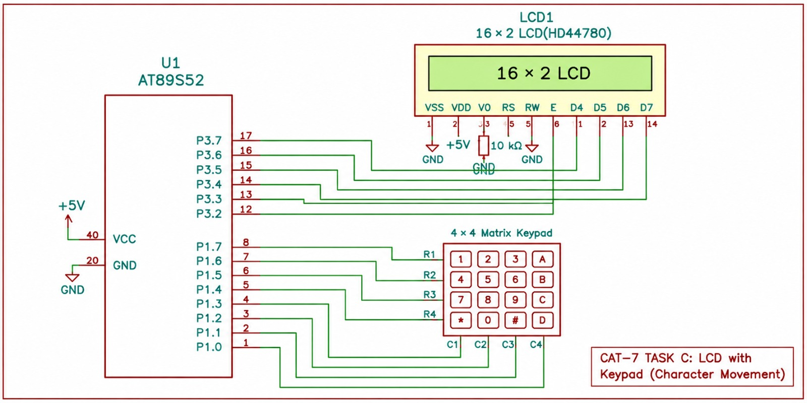

# EXPERIMENT DETAILS

**EXP:** CONTINUOUS LAB EVALUATION – 7

**DATE:** 24/08/2026

**NAME OF EXP:** 16×2 LCD Driver Development and Dynamic Display Control

**HARDWARE SETUP / PLATFORM:** Keil µVision + AT89S52 (8051) Development Board + HD44780-Compatible 16×2 LCD + 4×4 Matrix Keypad

---

## TASK 7C – 4×4 Keypad-Based Character Movement

### 1. Circuit Diagram

The experiment uses a 4×4 matrix keypad and a 16×2 HD44780-compatible LCD interfaced with the AT89S52 microcontroller. The keypad acts as the input device, allowing the user to move a character across the LCD using the designated directional keys.

- **Development Board:** AT89S52 (8051) Development Board
- **Microcontroller IC:** AT89S52
- **LCD Module:** 16×2 HD44780-Compatible LCD
- **Keypad Module:** 4×4 Matrix Keypad
- **LCD Communication Mode:** 4-bit mode
- **LCD Data Pins:** D4–D7 connected to P3.4–P3.7
- **Register Select (RS):** P3.2
- **Enable (E):** P3.3
- **Read/Write (RW):** GND (write-only operation)
- **Keypad Rows (R1–R4):** P1.0–P1.3 (outputs)
- **Keypad Columns (C1–C4):** P1.4–P1.7 (inputs with pull-ups)
- **Power Supply:** +5 V and GND
- **Contrast Pin (V0):** Connected to the middle terminal of a potentiometer for contrast adjustment

**Circuit Diagram:** 

### 2. Core Logic / Pseudocode / Code Base

**Working Principle:**

The experiment demonstrates an interactive LCD application in which a character is moved across a 16×2 LCD using a 4×4 matrix keypad.

The LCD is initialized in 4-bit mode, and the character **'O'** is initially displayed at the first row and first column.

The keypad is scanned continuously by driving one row LOW at a time and checking the column inputs to identify the pressed key. A debounce delay is used to reduce false key detection.

The following keys are assigned for directional movement:

| Key | Action |
|---|---|
| 2 | Move Up |
| 8 | Move Down |
| 4 | Move Left |
| 6 | Move Right |

When a valid directional key is pressed, the program erases the character from its previous position and displays it at the new cursor position. Boundary conditions prevent the character from moving outside the LCD display.

**Pseudocode:**

1. Initialize the LCD in 4-bit, 2-line mode.
2. Configure the keypad port for row outputs and column inputs.
3. Initialize the character position to row 0 and column 0.
4. Display the character 'O' at the initial position.
5. Continuously scan the keypad for a pressed key.
6. Drive each keypad row LOW one at a time and read the column inputs.
7. Identify the pressed key using the keypad key map.
8. Apply a debounce delay to verify the key press.
9. If key '2' is pressed, move the character one position UP, provided it is not already on the first row.
10. If key '8' is pressed, move the character one position DOWN, provided it is not already on the second row.
11. If key '4' is pressed, move the character one position LEFT, provided it is not in the first column.
12. If key '6' is pressed, move the character one position RIGHT, provided it is not in the last column.
13. Erase the character from its previous position.
14. Update the cursor position and display 'O' at the new position.
15. Wait until the key is released before accepting another press.
16. Repeat the process continuously.

**Code Base:**

The program is written in Embedded C using the `reg51.h` header file.

- `delay_ms()` – Generates software delays for LCD operations and keypad debouncing.
- `lcd_enable()` – Generates the Enable pulse to transfer commands or data to the LCD.
- `lcd_send_nibble()` – Sends a 4-bit nibble through the LCD data pins.
- `lcd_cmd()` – Sends command instructions to the LCD.
- `lcd_data()` – Sends character data to the LCD.
- `lcd_init()` – Initializes the LCD in 4-bit, 2-line mode.
- `lcd_goto(row, column)` – Positions the LCD cursor at the specified row and column.
- `keypad_scan()` – Scans the 4×4 matrix keypad and identifies the pressed key.
- `wait_key_release()` – Waits until the currently pressed key is released to ensure one movement per key press.
- `main()` – Initializes the LCD and keypad, displays the character 'O', and controls its movement based on keypad input.

The keypad scanning technique identifies the pressed key by checking the columns while activating each row individually. The LCD cursor-positioning function updates the character location based on the selected direction.

### 3. INFERENCE

The experiment demonstrates successful interfacing of a 4×4 matrix keypad and a 16×2 LCD with the AT89S52 microcontroller.

The character 'O' is moved across the LCD using the directional keys 2, 8, 4, and 6. The program identifies key presses through row-column scanning, applies debouncing, and updates the character position while preventing movement beyond the display boundaries.

This experiment demonstrates matrix keypad interfacing, GPIO-based input scanning, LCD cursor positioning, and interactive embedded system development using Embedded C.
