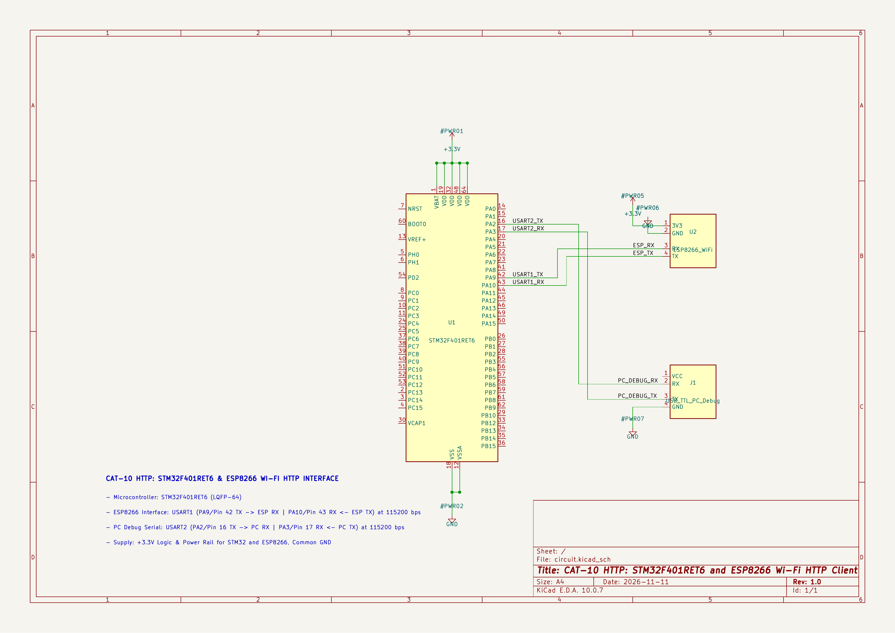

# EXPERIMENT DETAILS

**EXP:** CONTINUOUS LAB EVALUATION 10

**DATE:** 05/10/2026

**NAME OF EXP:** STM32–Wemos Wi-Fi Modem Interface using AT Commands

**HARDWARE SETUP / PLATFORM:** STM32CubeMX + Keil MDK + STM32 Development Board (Blue Pill – STM32F103C8T6) + Wemos D1 Mini (ESP8266)

---

## TASK 10A – Establish STM32 ↔ Wemos UART Communication

### 1. Circuit Diagram

The experiment establishes serial communication between the STM32 Blue Pill development board and the Wemos D1 Mini (ESP8266) using UART. A second UART connection is used to display the communication messages on the PC terminal.

- **Development Board:** STM32 Blue Pill
- **Microcontroller IC:** STM32F103C8T6
- **Wi-Fi Module:** Wemos D1 Mini (ESP8266)
- **UART1:** STM32 USART1 ↔ Wemos D1 Mini
- **UART2:** STM32 USART2 ↔ PC/PuTTY terminal
- **Baud Rate:** 115200
- **Data Format:** 8 data bits, no parity, 1 stop bit (8N1)

**Hardware Connections:**

| Wemos D1 Mini Pin | STM32 Blue Pill Pin | Description |
|---|---|---|
| TX | PA10 (USART1_RX) | Wemos transmits data to STM32 |
| RX | PA9 (USART1_TX) | STM32 transmits data to Wemos |
| GND | GND | Common ground |
| Power | Appropriate 3.3 V supply | Power supply for Wemos |

**PC Terminal Connection:**

USART2 is used for communication between the STM32 and the PC terminal. The corresponding UART pins are PA2 (USART2_TX) and PA3 (USART2_RX), connected through a suitable USB-to-UART interface.

### 2. Core Logic / Pseudocode / Code Base

**Working Principle:**

This experiment demonstrates UART communication between the STM32 microcontroller and the Wemos D1 Mini (ESP8266) using AT commands.

Two UART peripherals are configured:

- **USART1:** Used for sending AT commands to the Wemos module and receiving its responses.
- **USART2:** Used for displaying the commands and received responses on the PC terminal (PuTTY).

Both UART peripherals are configured with a baud rate of 115200, 8 data bits, no parity and 1 stop bit.

After initialization, the STM32 sends the `AT` command followed by carriage return and line feed (`\r\n`) to the ESP8266 through USART1.

The ESP8266 processes the command and sends a response, typically `OK`, back to the STM32. The STM32 receives the response byte by byte and forwards it to the PC terminal through USART2.

The AT command is sent only once during initialization. The program then remains in the infinite loop without repeatedly transmitting commands.

**Pseudocode:**

1. Initialize the HAL library.
2. Configure the system clock.
3. Initialize GPIO peripherals.
4. Initialize USART1 for communication with the Wemos module.
5. Initialize USART2 for communication with the PC terminal.
6. Display startup messages on the PC terminal.
7. Send the `AT` command to the ESP8266 through USART1.
8. Append carriage return and line feed to the command.
9. Wait for the response from the ESP8266.
10. Receive the response byte by byte.
11. Forward each received byte to the PC terminal through USART2.
12. If no response is received within the timeout period, display an error message.
13. Enter the infinite loop without sending the AT command again.

**Code Base:**

The experiment uses the following STM32 HAL functions:

| Purpose | HAL Function |
|---|---|
| Transmit data to Wemos | `HAL_UART_Transmit()` |
| Receive data from Wemos | `HAL_UART_Receive()` |
| Initialize UART peripherals | `HAL_UART_Init()` |
| Introduce delay | `HAL_Delay()` |
| Initialize HAL library | `HAL_Init()` |

The following user-defined functions are implemented:

- `UART_Send()`: Transmits messages to the PC terminal through USART2.
- `Wemos_Send()`: Transmits AT commands to the ESP8266 through USART1.
- `Send_AT_Command()`: Sends an AT command, receives the response and displays it on the PC terminal.

### 3. INFERENCE

The experiment demonstrates successful UART communication between the STM32 Blue Pill and the Wemos D1 Mini (ESP8266) using the AT command interface.

The STM32 transmits the `AT` command through USART1 and receives the modem response. The received characters are forwarded to the PC terminal through USART2, allowing the communication process to be monitored.

Thus, the experiment demonstrates serial communication using two UART peripherals, AT command transmission, response reception and UART-to-PC data forwarding using STM32 HAL functions.
