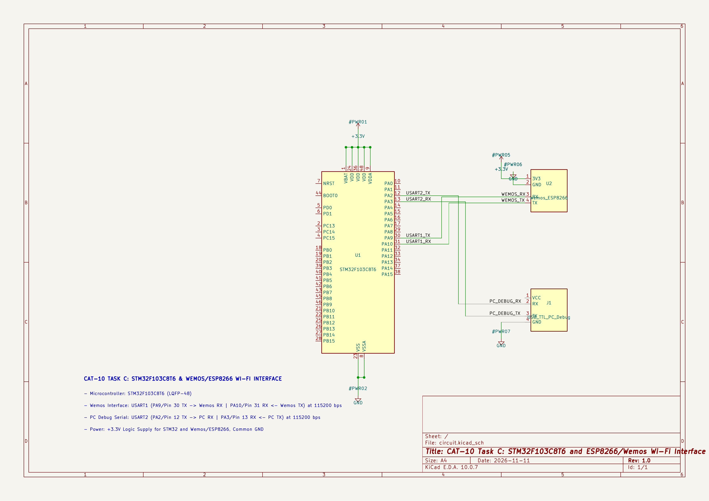

# EXPERIMENT DETAILS

**EXP:** CONTINUOUS LAB EVALUATION – 10

**DATE:** 05/10/2026

**NAME OF EXP:** STM32–Wemos Wi-Fi Modem Interface Using AT Commands

**HARDWARE SETUP / PLATFORM:** STM32 Development Board + Wemos D1 Mini (ESP8266) + Keil MDK + STM32CubeMX + PuTTY

---

## TASK 10C – ESP8266 AT Command Interface and Wi-Fi Configuration

### 1. Circuit Diagram

The experiment establishes UART communication between the STM32 microcontroller and the Wemos D1 Mini (ESP8266) Wi-Fi module. A second UART connection is used to communicate with the PC terminal for displaying AT commands and their responses.

- **Microcontroller:** STM32 Development Board
- **Wi-Fi Module:** Wemos D1 Mini (ESP8266)
- **Communication Interface:** UART
- **UART1:** STM32 ↔ Wemos ESP8266
- **UART2:** STM32 ↔ PC / PuTTY
- **Baud Rate:** 115200 bps for both UART interfaces
- **Data Bits:** 8 bits
- **Stop Bits:** 1
- **Parity:** None
- **Communication Mode:** Transmit and Receive
- **Terminal Software:** PuTTY

**UART Connections:**

| STM32 | Wemos D1 Mini | Purpose |
|---|---|---|
| UART1 TX | RX | Send AT commands to ESP8266 |
| UART1 RX | TX | Receive ESP8266 responses |
| GND | GND | Common ground |

The STM32 UART2 is connected to the PC through a suitable USB-to-TTL interface for displaying the communication output.

### 2. Core Logic / Pseudocode / Code Base

**Working Principle:**

The experiment demonstrates communication between the STM32 microcontroller and the ESP8266 Wi-Fi module using AT commands.

Two UART peripherals are configured in the STM32:

- **USART1:** Used for communication with the Wemos ESP8266.
- **USART2:** Used for communication with the PC terminal (PuTTY).

The STM32 sends predefined AT commands to the ESP8266 through USART1. The ESP8266 processes each command and returns a response. The STM32 receives the response character by character and forwards it to PuTTY through USART2.

The following AT commands are used:

| AT Command | Purpose |
|---|---|
| `AT` | Checks whether the ESP8266 responds |
| `AT+GMR` | Retrieves firmware version information |
| `AT+CWMODE=1` | Configures ESP8266 in Wi-Fi Station mode |
| `AT+CWLAP` | Scans for available Wi-Fi networks |
| `AT+CWJAP="SSID","PASSWORD"` | Connects to the specified Wi-Fi network |
| `AT+CIFSR` | Retrieves network information, including the IP address |

After sending all commands and displaying their responses, the STM32 remains in an infinite loop without repeatedly transmitting AT commands.

**Pseudocode:**

1. Initialize the HAL library.
2. Configure the system clock.
3. Initialize GPIO peripherals.
4. Initialize USART1 for communication with the ESP8266.
5. Initialize USART2 for communication with the PC terminal.
6. Display startup messages on PuTTY.
7. Send the `AT` command to check ESP8266 communication.
8. Send `AT+GMR` to retrieve the firmware version.
9. Send `AT+CWMODE=1` to configure Station mode.
10. Send `AT+CWLAP` to scan available Wi-Fi networks.
11. Send `AT+CWJAP` with the Wi-Fi SSID and password to connect to the network.
12. Send `AT+CIFSR` to retrieve network information and the IP address.
13. Receive the response from ESP8266 through USART1.
14. Forward the received response to the PC terminal through USART2.
15. Display an error message if no response is received.
16. After completing all commands, remain in an infinite loop.

**Code Base:**

The program is written in Embedded C using the STM32 HAL library.

- `SystemClock_Config()` – Configures the STM32 system clock using the external oscillator and PLL.
- `MX_GPIO_Init()` – Enables the required GPIO port clocks.
- `MX_USART1_UART_Init()` – Initializes USART1 for communication with the ESP8266 at 115200 baud.
- `MX_USART2_UART_Init()` – Initializes USART2 for communication with the PC terminal at 115200 baud.
- `UART_Send()` – Transmits strings to the PC terminal through USART2.
- `Wemos_Send()` – Transmits AT commands to the ESP8266 through USART1.
- `Send_AT_Command()` – Sends an AT command, receives the ESP8266 response, forwards the response to PuTTY, and reports if no response is received.
- `HAL_UART_Transmit()` – Transmits data through the selected UART peripheral.
- `HAL_UART_Receive()` – Receives response characters from the ESP8266.
- `HAL_Delay()` – Provides a delay between successive AT commands.

### 3. INFERENCE

The experiment demonstrates successful UART communication between the STM32 microcontroller and the Wemos D1 Mini (ESP8266) Wi-Fi module.

The STM32 transmits predefined AT commands through USART1 and receives the corresponding responses from the ESP8266. The received responses are forwarded to the PC terminal through USART2, allowing the communication process to be monitored using PuTTY.

The experiment covers ESP8266 response verification, firmware identification, Wi-Fi Station mode configuration, network scanning, Wi-Fi connection, and IP address retrieval.

This demonstrates UART interfacing, communication with an external Wi-Fi modem, AT command handling, and the basic configuration required to establish Wi-Fi connectivity using an STM32 microcontroller.
