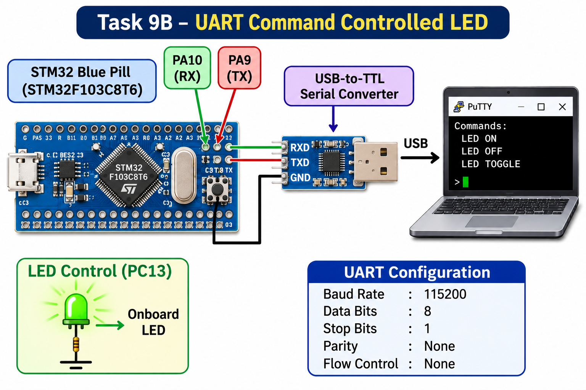

# EXPERIMENT DETAILS

**EXP:** CONTINUOUS LAB EVALUATION – 9

**DATE:** 28/09/2026

**NAME OF EXP:** STM32 UART Command Controlled LED

**HARDWARE SETUP / PLATFORM:** STM32 Development Board + Keil MDK + STM32CubeMX + PC Terminal (PuTTY)

---

## TASK 9B – String-Based Application Logic

### 1. Circuit Diagram

The experiment uses UART communication between the STM32 microcontroller and a PC terminal to control the onboard LED using text-based commands.

- **Development Board:** STM32 Development Board
- **Communication Interface:** USART1
- **Baud Rate:** 115200 bps
- **Data Bits:** 8 bits
- **Stop Bits:** 1
- **Parity:** None
- **Communication Mode:** Transmit and Receive
- **LED Pin:** PC13 (Onboard LED)
- **Terminal Software:** PuTTY
- **UART Connection:** USART1 TX and RX connected to the corresponding USB-to-TTL converter RX and TX pins.
- **Ground:** Common GND between the STM32 board and USB-to-TTL converter.

### 2. Core Logic / Pseudocode / Code Base

**Working Principle:**

The experiment demonstrates a UART-based command interface for controlling the onboard LED of the STM32 microcontroller.

The STM32 receives characters from the PC terminal through USART1 using the `HAL_UART_Receive()` function. Each received character is immediately echoed back to the terminal using `HAL_UART_Transmit()`.

The received characters are stored in a command buffer until the Enter key is pressed. Once the complete command is received, the program compares the string with predefined commands using the `strcmp()` function.

The LED responds according to the entered command:

| Command | System Response |
|---|---|
| LED ON | Turns ON the onboard LED |
| LED OFF | Turns OFF the onboard LED |
| LED TOGGLE | Changes the current LED state |

**Pseudocode:**

1. Initialize the HAL library and system clock.
2. Configure GPIO pins and initialize USART1.
3. Declare a character variable to receive UART data.
4. Create a command buffer to store the received string.
5. Display the available commands on the PC terminal.
6. Continuously receive one character from the terminal.
7. Echo the received character back to the terminal.
8. Check whether the received character is Enter (`\r` or `\n`).
9. If Enter is detected:
   - Add the null character (`\0`) to terminate the command string.
   - Compare the received command with the predefined commands.
   - If the command is `LED ON`, turn ON the LED.
   - If the command is `LED OFF`, turn OFF the LED.
   - If the command is `LED TOGGLE`, toggle the LED state.
   - If the command is invalid, display an error message.
   - Reset the command buffer index.
10. Otherwise, store the received character in the command buffer.
11. Repeat the process continuously.

**Code Base:**

The program is written in Embedded C using the STM32 HAL library.

- `SystemClock_Config()` – Configures the system clock using the external oscillator and PLL.
- `MX_GPIO_Init()` – Configures PC13 as a GPIO output for LED control.
- `MX_USART1_UART_Init()` – Initializes USART1 with a baud rate of 115200, 8 data bits, no parity, and 1 stop bit.
- `UART_Send()` – Transmits a string through USART1.
- `HAL_UART_Receive()` – Receives one character from the PC terminal.
- `HAL_UART_Transmit()` – Transmits the received character back to the terminal.
- `strcmp()` – Compares the received command with predefined command strings.
- `HAL_GPIO_WritePin()` – Controls the LED by setting or resetting the GPIO output.
- `HAL_GPIO_TogglePin()` – Toggles the current LED state.

The onboard LED connected to PC13 is active-low in this program. Therefore, writing `GPIO_PIN_RESET` turns the LED ON, while writing `GPIO_PIN_SET` turns it OFF.

### 3. INFERENCE

The experiment demonstrates successful UART-based communication between the STM32 microcontroller and a PC terminal. The microcontroller receives character-by-character input, echoes the received characters, and processes complete command strings when the Enter key is pressed.

Using string comparison, the system recognizes the commands `LED ON`, `LED OFF`, and `LED TOGGLE` and performs the corresponding LED operations. Invalid commands are also identified and reported.

This experiment demonstrates UART character reception and transmission, string-based command processing, GPIO control, and the development of a simple command-driven embedded application using STM32 HAL libraries.
